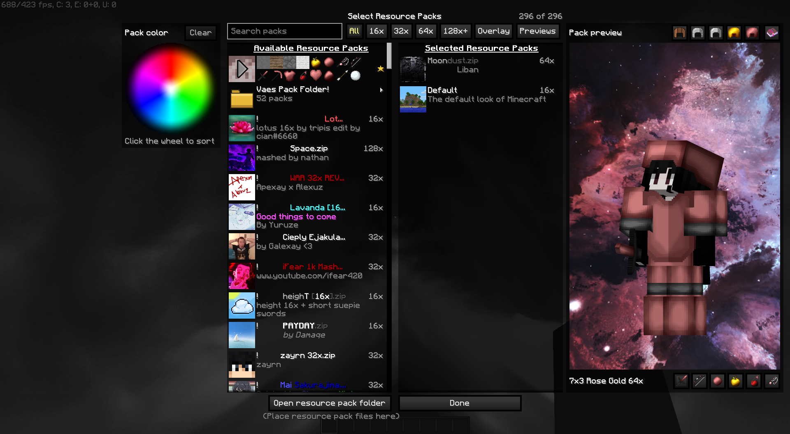
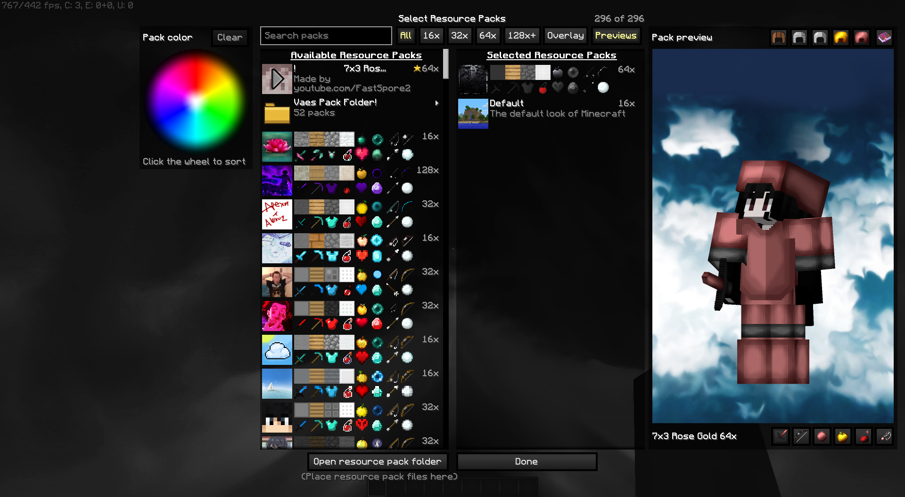
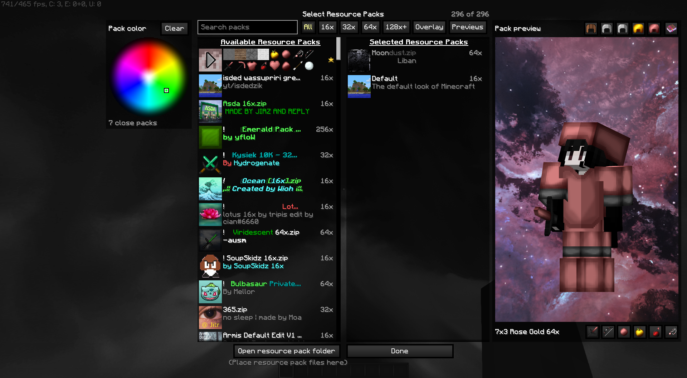
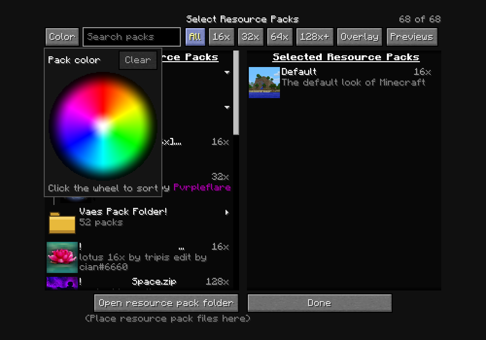
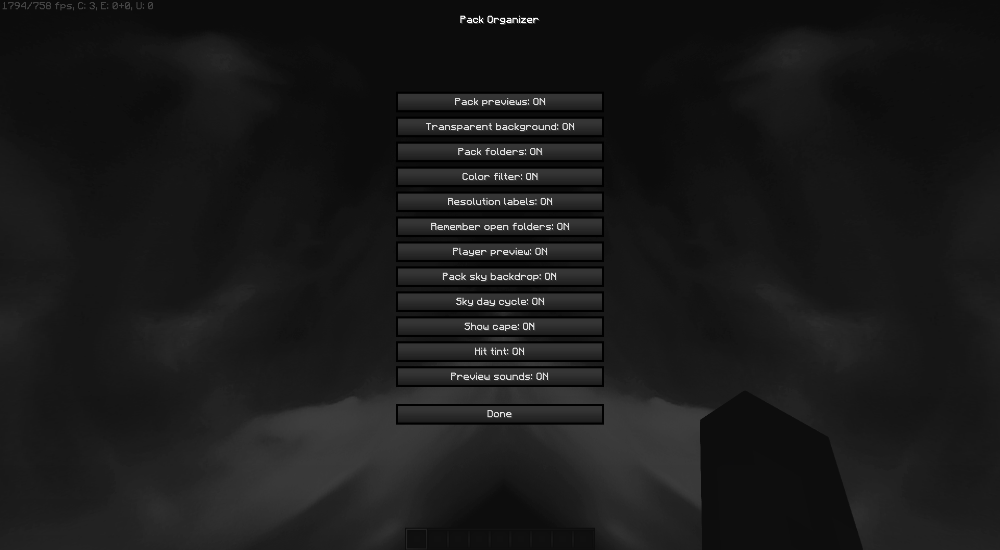

# Pack Organizer

A Forge 1.8.9 mod that upgrades the Resource Packs screen: it opens fast, keeps a big pack collection organized, and shows each pack on your own player before you turn it on. It works alone or alongside [fastpacks](https://github.com/as9pa/fastpacks).

## Features

- **Performance boost.** The fastpacks speed-ups are built in: names are worked out once per scan, `pack.png` icons load in the background, and rows outside the list are not drawn. In my own testing with OptiFine, opening the screen went from about 21 seconds to under 0.2 seconds. New in 0.4.0; see [SPEEDUPS.md](docs/SPEEDUPS.md).
- **Search and filters.** A search box, resolution chips (16x, 32x, 64x, 128x+, Overlay) and resolution labels on every row.
- **Pack folders.** Packs in subfolders of `resourcepacks` show up as collapsible folders, at any depth.
- **Favorites.** Hover a pack and click the star to pin it first in its folder and in search results. New in 0.4.0.
- **Player preview.** A 3D model with your own skin wears the hovered pack's armor and holds its items. Hit it, draw the bow, throw a pearl or potion, or eat an apple, with the pack's own sounds. A thrown pearl now plays the teleport sound where it lands (new in 0.4.0).

### Item previews

Hover a pack to see its sword, pearls, blocks and other items, or turn on Previews mode to show them on every row.

### Color wheel

Click a color to sort packs by how close their diamond sword and armor are to it, closest first.

### Small windows

On a narrow window the layout tightens and the color wheel moves into a Color button popup.

### Settings

Every feature can be turned off under Mods > Pack Organizer > Config.

## Install

Put `packorganizer-0.4.0.jar` in `.minecraft\mods` and remove any older copy. Works alone or with fastpacks.

See [docs/details.md](docs/details.md) for the full feature list and settings.
